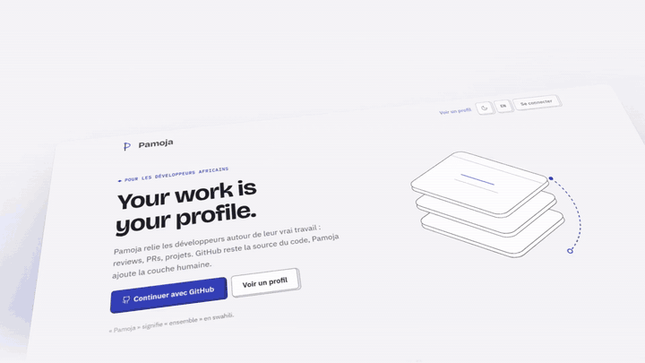

# Pamoja

**Your work is your profile.**

[🇫🇷 Français](README.md) · 🇬🇧 English

[**Open the live demo**](https://pamoja-tech.duckdns.org) ·
[**Watch the preview**](#preview)

Pamoja ("together" in Swahili) is the network where African developers
collaborate on real projects. A developer imports their GitHub project, asks for
precise help (review a PR, unblock a bug, find a contributor), the request goes
to the developers who have the right skill, and help **verified on GitHub**
becomes reputation shown on their profile. GitHub stays the source of the code;
Pamoja adds the human layer: discovery, mutual help, project organisation and
proof of what each person can do.

Built for the **CADEV** competition, hosted on the Senegalese sovereign cloud
**Systalink**. The product and its specification are in French.

## Preview

<a href="docs/vitrine/pamoja-apercu.mp4">
  
</a>

*Click the preview to open the full video. The code that renders it lives in
[`docs/vitrine/`](docs/vitrine/), reusable for every new release.*

## Why

According to [State of Dev Sénégal 2026](docs/etudes/state-of-dev-senegal-2026.md)
(624 respondents, Galsen DEV community), developers want to contribute and be
seen, but don't know where to start, and their work is scattered: code on
GitHub, discussions on WhatsApp or Discord, visibility on LinkedIn. In the age of
AI, when anyone can show code, what sets a developer apart is what they
**actually** reviewed, fixed and shipped with others. Pamoja measures it from
GitHub, without self-declared claims.

Principles: *Build > Scroll*, *Collaboration > Connection*, *Evidence > Claims*
([specification §1](docs/cahier-des-charges.md#1-vision-et-positionnement)).

## Run it

Three ways, from the quickest to the most hackable. Each one opens Pamoja locally
with the **demo data** (9 developers from several countries, 8 communities, 5
projects) and **no GitHub App**: **Continuer avec GitHub** signs you straight
into Abdou's demo account, with no password. This simulated sign-in never exists
in production ([`api/github-oauth.ts`](api/github-oauth.ts),
[`api/lib/production.ts`](api/lib/production.ts)).

Commands use Bash (Git Bash on Windows). Without an AI key, the Assistant and the
summaries say so and the rest of the app works; without Meilisearch, search
falls back to SQL ([`api/search.ts`](api/search.ts)).

### 1. Pull the published image (nothing to build)

Docker only. The image is built and published by GitHub on every push to
`master`, after green CI ([`.github/workflows/publish.yml`](.github/workflows/publish.yml)).

```bash
docker volume create pamoja-data
docker run --rm -v pamoja-data:/data -e APP_ENV=dev -e SEED_GITHUB_IDS=abdou:84472218 \
  ghcr.io/mirak29/pamoja:latest seed
docker run -d --name pamoja -p 8000:8000 -v pamoja-data:/data \
  -e APP_ENV=dev -e SEED_GITHUB_IDS=abdou:84472218 \
  ghcr.io/mirak29/pamoja:latest --local
```

The first command fills the demo database, the second starts the app on
<http://localhost:8000>. `--local` lets the production build run on a laptop,
with the simulated sign-in ([`deploy/main.ts`](deploy/main.ts)). Stop it with
`docker stop pamoja`; the database stays in the `pamoja-data` volume.

### 2. Clone the repository and build the image

The same image, built from the code ([`Dockerfile`](Dockerfile)):

```bash
git clone https://github.com/Mirak29/pamoja.git
cd pamoja
docker build -t pamoja .
docker volume create pamoja-data
docker run --rm -v pamoja-data:/data -e APP_ENV=dev -e SEED_GITHUB_IDS=abdou:84472218 pamoja seed
docker run -d --name pamoja -p 8000:8000 -v pamoja-data:/data \
  -e APP_ENV=dev -e SEED_GITHUB_IDS=abdou:84472218 pamoja --local
```

For a server with HTTPS, a real GitHub App, Meilisearch and backups:
[`docs/deploiement.md`](docs/deploiement.md) (French) and
[`docker-compose.yml`](docker-compose.yml).

### 3. Clone the repository and run it with Deno (development)

Deno **2.9.8** (the one in the image), no Node, hot reload, a local SQLite file
(`pamoja.db`).

```bash
git clone https://github.com/Mirak29/pamoja.git
cd pamoja
deno install
deno task seed
deno task dev
```

The app opens on <http://localhost:8800>. `deno task dev` also runs the tests,
formatting and lint in watch mode. The dev configuration is in
[`.env-dev`](.env-dev); personal keys (AI, a dev GitHub App) go in a `.env-local`
file, ignored by Git, with the names of
[`.env.production.example`](.env.production.example).

| Command | What it does |
| --- | --- |
| `deno task seed` | resets the demo database ([`api/seed.ts`](api/seed.ts)) |
| `deno task test` | API and web tests, in-memory SQLite, no network |
| `deno task check` · `lint` · `fmt` | types, lint, formatting (what [CI](.github/workflows/ci.yml) checks) |
| `deno task tunnel` | a public HTTPS address to receive GitHub webhooks in dev ([`task-tunnel.ts`](task-tunnel.ts)) |
| `deno task stress` | thousands of rows in the dev database, to test the screens ([`api/stress.ts`](api/stress.ts)) |
| `deno task prod:local` | the production build on your machine |

The HTTP load test (k6) is described in [`qa/load/README.md`](qa/load/README.md).

## What Pamoja does

| Feature | What it brings | Reference |
| --- | --- | --- |
| **GitHub sign-in and import** | GitHub App, repo import (README, issues, PRs, CI), sync by webhooks and ETag refresh | [§5](docs/cahier-des-charges.md#5-github--authentification-import-synchronisation) · [`api/import.ts`](api/import.ts) · [`api/sync.ts`](api/sync.ts) · [`api/webhooks.ts`](api/webhooks.ts) |
| **Help requests and matching** | a precise request (PR review, debugging…) goes to the right developers, by skills and embeddings | [§7](docs/cahier-des-charges.md#7-demandes-daide-matching-notifications-et-reviews) · [`api/help.ts`](api/help.ts) · [`api/matching.ts`](api/matching.ts) |
| **Verified reviews** | a review counts only once GitHub confirms it on the PR | [§7.5](docs/cahier-des-charges.md#75-vérification-dune-review) · [`api/review-check.ts`](api/review-check.ts) |
| **Reputation, badges, proofs** | reputation per dimension, badges, proofs moderation can withdraw | [§8](docs/cahier-des-charges.md#8-réputation-badges-et-anti-abus) · [`api/reputation.ts`](api/reputation.ts) · [`api/badges.ts`](api/badges.ts) · [`api/proofs.ts`](api/proofs.ts) |
| **Project page** | Pulse, DNA, Health, Story, needs, team, gallery | [§6.3–6.6](docs/cahier-des-charges.md#63-page-projet) · [`api/pulse.ts`](api/pulse.ts) · [`api/project-dna.ts`](api/project-dna.ts) |
| **Board and roadmap** | cards linked to issues and PRs, moved to *Done* on merge, milestones and criteria | [§6.7](docs/cahier-des-charges.md#67-board-et-roadmap) · [`api/board.ts`](api/board.ts) · [`api/roadmap.ts`](api/roadmap.ts) |
| **Channels and messages** | project channels, `#suivi` fed by CI, direct messages, presence | [§6.8](docs/cahier-des-charges.md#68-canaux-du-projet-et-présence) · [§10.6](docs/cahier-des-charges.md#106-messages-directs) · [`api/channels.ts`](api/channels.ts) · [`api/messages.ts`](api/messages.ts) |
| **Profile and Share Card** | a profile built from proofs, a share image rendered by the server | [§9](docs/cahier-des-charges.md#9-profil-développeur-et-partage) · [§17.2](docs/cahier-des-charges.md#172-share-card-et-images-og) · [`api/share-card.ts`](api/share-card.ts) · [`api/og.ts`](api/og.ts) |
| **Feed, communities, explore** | a feed by communities and follows, reposts, search, discovery by country and tech | [§10](docs/cahier-des-charges.md#10-communautés-feed-exploration-et-recherche) · [`api/posts.ts`](api/posts.ts) · [`api/explore.ts`](api/explore.ts) · [`api/search.ts`](api/search.ts) |
| **Moderation** | reports, community moderators, suspension reserved to admins | [§10.5](docs/cahier-des-charges.md#105-signalement-et-modération) · [`api/moderation.ts`](api/moderation.ts) |
| **Real time** | notifications and updates without reloading, over SSE | [§13](docs/cahier-des-charges.md#13-temps-réel--entries-et-sse) · [`api/events.ts`](api/events.ts) · [`api/notifications.ts`](api/notifications.ts) |
| **AI** | Assistant and summaries (Meta, then Gemini, then Groq), with a capped daily budget | [§11](docs/cahier-des-charges.md#11-ia) · [`api/llm.ts`](api/llm.ts) · [`api/assistant.ts`](api/assistant.ts) |

## Architecture

One Deno instance, SQLite, SSE: no microservices until the product needs them
([§12](docs/cahier-des-charges.md#12-architecture-technique)).

```
api/          the server: routes, domain, GitHub, real time, AI
  routes.ts       every API route, typed
  schema.ts       the data model (SQLite)
  events.ts       who receives what, in real time
web/          Preact + signals, compiled Tailwind v4
  pages/          one page per screen
  ui/             shared components
migrations/   SQLite migrations, run at startup
deploy/       the image entry point, Caddy, the backup copy
docs/         specification, deployment, studies, identity, QA
qa/load/      the HTTP load test
```

| Layer | Choice |
| --- | --- |
| Server | Deno 2.9, [`@01edu/api`](https://jsr.io/@01edu/api), [`@01edu/db`](https://jsr.io/@01edu/db) (SQLite) |
| Client | Preact, `@preact/signals`, Tailwind v4 |
| Real time | SQLite entries + Server-Sent Events |
| Search | Meilisearch, SQL as fallback |
| Images | satori + resvg (Share Card, OG previews) |
| Production | one compiled binary on Alpine, Caddy (HTTPS, HTTP/3), hourly backups |

## Documentation (in French)

| Document | Content |
| --- | --- |
| [Specification](docs/cahier-des-charges.md) | the reference of the product and technical choices (§1 to §20) |
| [`TODO.md`](TODO.md) | `PAM-xxx` tasks, schedule, decision log |
| [Project log](docs/suivi-projet.md) | what was delivered, task by task |
| [Modelling](docs/modelisation/) | architecture, data model, states and sequences, as images |
| [Deployment](docs/deploiement.md) | the VM, the image, secrets, backups, updates |
| [State of Dev Sénégal 2026](docs/etudes/state-of-dev-senegal-2026.md) | the survey figures and what Pamoja takes from them |
| [Identity](docs/identite/) | the logo and design tokens |
| [Prototype](docs/prototype/) | the interactive prototype that validated the experience |
| [QA reports](docs/qa/) | QA and code review campaigns |

## Environment

The commented template is [`.env.production.example`](.env.production.example).

| Variable | Role |
| --- | --- |
| `SESSION_SECRET` | signs session cookies |
| `GITHUB_CLIENT_ID`, `GITHUB_CLIENT_SECRET`, `GITHUB_APP_SLUG`, `GITHUB_APP_ID`, `GITHUB_APP_PRIVATE_KEY`, `GITHUB_WEBHOOK_SECRET` | the GitHub App: sign-in, installation, webhooks |
| `GITHUB_BOT_TOKEN` | reads public repos |
| `META_API_KEY`, `GEMINI_API_KEY`, `GROQ_API_KEY` | the models, tried in this order |
| `AI_DAILY_BUDGET` | dollars spent per day at most at Meta (1 by default) |
| `PAMOJA_ADMINS` | logins of the platform admins |
| `PUBLIC_HOST` | the domain of shared links and previews |
| `MEILI_URL`, `MEILI_MASTER_KEY` | search |
| `SEED_GITHUB_IDS` | demo developers that are real GitHub accounts (`login:id`) |

## Team

Abdou ([@Mirak29](https://github.com/Mirak29)) and niangoos
([@NiangOos](https://github.com/NiangOos)).
