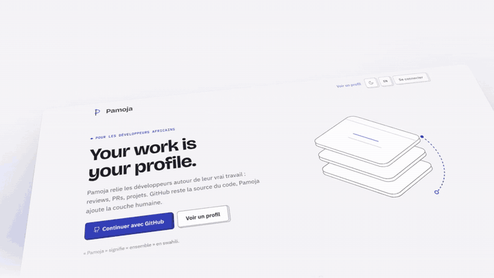

# Pamoja

**Your work is your profile.**

🇫🇷 Français · [🇬🇧 English](README.en.md)

[**Ouvrir la démo en ligne**](https://pamoja-tech.duckdns.org) ·
[**Voir l'aperçu vidéo**](#aperçu)

Pamoja (« ensemble » en swahili) est le réseau où les développeurs africains
collaborent sur de vrais projets. Un développeur importe son projet GitHub,
demande une aide précise (relire une PR, débloquer un bug, trouver un
contributeur), la demande part vers les développeurs qui ont la bonne
compétence, et l'aide **vérifiée sur GitHub** devient de la réputation visible
sur son profil. GitHub reste la source du code ; Pamoja ajoute la couche
humaine : la découverte, l'entraide, l'organisation du projet et la preuve de ce
que chacun sait faire.

Construit pour le concours **CADEV**, hébergé sur le cloud souverain sénégalais
**Systalink**.

## Aperçu

<a href="docs/vitrine/pamoja-apercu.mp4">
  
</a>

*Cliquer sur l'aperçu ouvre la vidéo complète. Le code qui la produit est dans
[`docs/vitrine/`](docs/vitrine/), réutilisable pour chaque nouvelle version.*

## Pourquoi

D'après le [State of Dev Sénégal 2026](docs/etudes/state-of-dev-senegal-2026.md)
(624 répondants, Galsen DEV), les développeurs veulent contribuer et se montrer,
mais ne savent pas par où commencer, et leur travail reste dispersé : le code sur
GitHub, les échanges sur WhatsApp ou Discord, la visibilité sur LinkedIn. À l'ère
de l'IA, où n'importe qui peut afficher du code, ce qui distingue un développeur,
c'est ce qu'il a **vraiment** relu, corrigé et livré avec d'autres. Pamoja le
mesure à partir de GitHub, sans déclaration.

Principes : *Build > Scroll*, *Collaboration > Connection*, *Evidence > Claims*
([cahier des charges §1](docs/cahier-des-charges.md#1-vision-et-positionnement)).

## Lancer l'app

Trois méthodes, de la plus rapide à la plus modifiable. Chacune ouvre Pamoja en
local avec les **données de démo** (9 développeurs de plusieurs pays, 8
communautés, 5 projets) et **sans GitHub App** : **Continuer avec GitHub**
connecte directement au compte de démo d'Abdou, sans mot de passe. Ce mode
simulé n'existe jamais en production
([`api/github-oauth.ts`](api/github-oauth.ts), [`api/lib/production.ts`](api/lib/production.ts)).

Les commandes sont en Bash (Git Bash sous Windows). Sans clé d'IA, l'Assistant et
les résumés le disent et le reste de l'app fonctionne ; sans Meilisearch, la
recherche passe en SQL ([`api/search.ts`](api/search.ts)).

### 1. L'image publiée (rien à construire)

Docker seulement. L'image est construite et publiée par GitHub à chaque push sur
`master`, après une CI au vert ([`.github/workflows/publish.yml`](.github/workflows/publish.yml)).

```bash
docker volume create pamoja-data
docker run --rm -v pamoja-data:/data -e APP_ENV=dev -e SEED_GITHUB_IDS=abdou:84472218 \
  ghcr.io/mirak29/pamoja:latest seed
docker run -d --name pamoja -p 8000:8000 -v pamoja-data:/data \
  -e APP_ENV=dev -e SEED_GITHUB_IDS=abdou:84472218 \
  ghcr.io/mirak29/pamoja:latest --local
```

La première commande remplit la base de démo, la seconde lance l'app sur
<http://localhost:8000>. `--local` autorise le build de production à tourner sur
un poste, avec la connexion simulée ([`deploy/main.ts`](deploy/main.ts)).
Arrêter avec `docker stop pamoja` ; la base reste dans le volume `pamoja-data`.

### 2. Cloner le dépôt et construire l'image

La même image, construite depuis le code ([`Dockerfile`](Dockerfile)) :

```bash
git clone https://github.com/Mirak29/pamoja.git
cd pamoja
docker build -t pamoja .
docker volume create pamoja-data
docker run --rm -v pamoja-data:/data -e APP_ENV=dev -e SEED_GITHUB_IDS=abdou:84472218 pamoja seed
docker run -d --name pamoja -p 8000:8000 -v pamoja-data:/data \
  -e APP_ENV=dev -e SEED_GITHUB_IDS=abdou:84472218 pamoja --local
```

Pour un serveur avec HTTPS, une vraie GitHub App, la recherche Meilisearch et
les sauvegardes : [`docs/deploiement.md`](docs/deploiement.md) et
[`docker-compose.yml`](docker-compose.yml).

### 3. Cloner le dépôt et lancer avec Deno (développement)

Deno **2.9.8** (celui de l'image), sans Node, rechargement à chaud, une base
SQLite locale (`pamoja.db`).

```bash
git clone https://github.com/Mirak29/pamoja.git
cd pamoja
deno install
deno task seed
deno task dev
```

L'app s'ouvre sur <http://localhost:8800>. `deno task dev` lance aussi, en
parallèle, les tests, le formatage et le lint en mode watch. La configuration de
dev est dans [`.env-dev`](.env-dev) ; les clés personnelles (IA, GitHub App de
dev) vont dans un fichier `.env-local`, ignoré par Git, avec les noms de
[`.env.production.example`](.env.production.example).

| Commande | Ce qu'elle fait |
| --- | --- |
| `deno task seed` | remet la base de démo à zéro ([`api/seed.ts`](api/seed.ts)) |
| `deno task test` | les tests de l'API et du web, SQLite en mémoire, sans réseau |
| `deno task check` · `lint` · `fmt` | typage, lint, formatage (ce que vérifie la [CI](.github/workflows/ci.yml)) |
| `deno task tunnel` | une adresse HTTPS publique pour recevoir les webhooks GitHub en dev ([`task-tunnel.ts`](task-tunnel.ts)) |
| `deno task stress` | des milliers de lignes dans la base de dev, pour tester les écrans ([`api/stress.ts`](api/stress.ts)) |
| `deno task prod:local` | le build de production sur le poste |

Le test de charge HTTP (k6) est décrit dans [`qa/load/README.md`](qa/load/README.md).

## Ce que fait Pamoja

| Fonctionnalité | Ce que ça apporte | Référence |
| --- | --- | --- |
| **Connexion et import GitHub** | GitHub App, import d'un repo (README, issues, PRs, CI), synchro par webhooks et rafraîchissement avec ETag | [§5](docs/cahier-des-charges.md#5-github--authentification-import-synchronisation) · [`api/import.ts`](api/import.ts) · [`api/sync.ts`](api/sync.ts) · [`api/webhooks.ts`](api/webhooks.ts) |
| **Demandes d'aide et matching** | une demande précise (review de PR, debug…) part vers les bons développeurs, par compétences et embeddings | [§7](docs/cahier-des-charges.md#7-demandes-daide-matching-notifications-et-reviews) · [`api/help.ts`](api/help.ts) · [`api/matching.ts`](api/matching.ts) |
| **Reviews vérifiées** | une review compte seulement si GitHub la confirme sur la PR | [§7.5](docs/cahier-des-charges.md#75-vérification-dune-review) · [`api/review-check.ts`](api/review-check.ts) |
| **Réputation, badges, preuves** | réputation par dimension, badges, preuves retirables par la modération | [§8](docs/cahier-des-charges.md#8-réputation-badges-et-anti-abus) · [`api/reputation.ts`](api/reputation.ts) · [`api/badges.ts`](api/badges.ts) · [`api/proofs.ts`](api/proofs.ts) |
| **Page projet** | Pulse, DNA, Health, Story, besoins, équipe, galerie | [§6.3–6.6](docs/cahier-des-charges.md#63-page-projet) · [`api/pulse.ts`](api/pulse.ts) · [`api/project-dna.ts`](api/project-dna.ts) |
| **Board et roadmap** | cartes liées aux issues et PRs, passées en *Done* au merge, jalons et critères | [§6.7](docs/cahier-des-charges.md#67-board-et-roadmap) · [`api/board.ts`](api/board.ts) · [`api/roadmap.ts`](api/roadmap.ts) |
| **Canaux et messages** | canaux de projet, `#suivi` alimenté par la CI, messages directs, présence | [§6.8](docs/cahier-des-charges.md#68-canaux-du-projet-et-présence) · [§10.6](docs/cahier-des-charges.md#106-messages-directs) · [`api/channels.ts`](api/channels.ts) · [`api/messages.ts`](api/messages.ts) |
| **Profil et Share Card** | profil construit par les preuves, image de partage générée par le serveur | [§9](docs/cahier-des-charges.md#9-profil-développeur-et-partage) · [§17.2](docs/cahier-des-charges.md#172-share-card-et-images-og) · [`api/share-card.ts`](api/share-card.ts) · [`api/og.ts`](api/og.ts) |
| **Fil, communautés, explore** | fil par communautés et abonnements, reposts, recherche, découverte par pays et techno | [§10](docs/cahier-des-charges.md#10-communautés-feed-exploration-et-recherche) · [`api/posts.ts`](api/posts.ts) · [`api/explore.ts`](api/explore.ts) · [`api/search.ts`](api/search.ts) |
| **Modération** | signalements, modérateurs de communauté, suspension réservée aux admins | [§10.5](docs/cahier-des-charges.md#105-signalement-et-modération) · [`api/moderation.ts`](api/moderation.ts) |
| **Temps réel** | notifications et mises à jour sans recharger, par SSE | [§13](docs/cahier-des-charges.md#13-temps-réel--entries-et-sse) · [`api/events.ts`](api/events.ts) · [`api/notifications.ts`](api/notifications.ts) |
| **IA** | Assistant et résumés (Meta, puis Gemini, puis Groq), budget quotidien plafonné | [§11](docs/cahier-des-charges.md#11-ia) · [`api/llm.ts`](api/llm.ts) · [`api/assistant.ts`](api/assistant.ts) |

## Architecture

Une instance Deno, SQLite, SSE : pas de microservices tant que le produit n'en a
pas besoin ([§12](docs/cahier-des-charges.md#12-architecture-technique)).

```
api/          le serveur : routes, domaine, GitHub, temps réel, IA
  routes.ts       toutes les routes de l'API, typées
  schema.ts       le modèle de données (SQLite)
  events.ts       qui reçoit quoi, en temps réel
web/          Preact + signals, Tailwind v4 compilé
  pages/          une page par écran
  ui/             les composants partagés
migrations/   les migrations SQLite, jouées au démarrage
deploy/       le point d'entrée de l'image, Caddy, la copie des sauvegardes
docs/         cahier des charges, déploiement, études, identité, QA
qa/load/      le test de charge HTTP
```

| Couche | Choix |
| --- | --- |
| Serveur | Deno 2.9, [`@01edu/api`](https://jsr.io/@01edu/api), [`@01edu/db`](https://jsr.io/@01edu/db) (SQLite) |
| Client | Preact, `@preact/signals`, Tailwind v4 |
| Temps réel | entries SQLite + Server-Sent Events |
| Recherche | Meilisearch, SQL en secours |
| Images | satori + resvg (Share Card, aperçus OG) |
| Production | un binaire compilé sur Alpine, Caddy (HTTPS, HTTP/3), sauvegardes horaires |

## Documentation

| Document | Contenu |
| --- | --- |
| [Cahier des charges](docs/cahier-des-charges.md) | la référence du produit et des choix techniques (§1 à §20) |
| [`TODO.md`](TODO.md) | les tâches `PAM-xxx`, le planning, le journal des décisions |
| [Suivi de projet](docs/suivi-projet.md) | ce qui a été livré, tâche par tâche |
| [Modélisation](docs/modelisation/) | l'architecture, le modèle de données, les états, les séquences, en images |
| [Déploiement](docs/deploiement.md) | la VM, l'image, les secrets, les sauvegardes, la mise à jour |
| [State of Dev Sénégal 2026](docs/etudes/state-of-dev-senegal-2026.md) | les chiffres de l'étude et ce que Pamoja en retient |
| [Identité](docs/identite/) | le logo et les tokens de design |
| [Prototype](docs/prototype/) | le prototype interactif qui a validé l'expérience |
| [Rapports de QA](docs/qa/) | les campagnes de QA et de revue de code |

## Variables d'environnement

Le modèle commenté est [`.env.production.example`](.env.production.example).

| Variable | Rôle |
| --- | --- |
| `SESSION_SECRET` | signe les cookies de session |
| `GITHUB_CLIENT_ID`, `GITHUB_CLIENT_SECRET`, `GITHUB_APP_SLUG`, `GITHUB_APP_ID`, `GITHUB_APP_PRIVATE_KEY`, `GITHUB_WEBHOOK_SECRET` | la GitHub App : connexion, installation, webhooks |
| `GITHUB_BOT_TOKEN` | lit les repos publics |
| `META_API_KEY`, `GEMINI_API_KEY`, `GROQ_API_KEY` | les modèles, essayés dans cet ordre |
| `AI_DAILY_BUDGET` | dollars dépensés par jour au plus chez Meta (1 par défaut) |
| `PAMOJA_ADMINS` | logins des admins de la plateforme |
| `PUBLIC_HOST` | le domaine des liens partagés et des aperçus |
| `MEILI_URL`, `MEILI_MASTER_KEY` | la recherche |
| `SEED_GITHUB_IDS` | les développeurs de démo qui sont de vrais comptes GitHub (`login:id`) |

## Équipe

Abdou ([@Mirak29](https://github.com/Mirak29)) et niangoos
([@NiangOos](https://github.com/NiangOos)).
