# Modélisation du backend

Diagrammes du backend de Pamoja, tirés du [cahier des charges](../cahier-des-charges.md) et vérifiés sur le schéma réel ([`api/schema.ts`](../../api/schema.ts), toutes migrations jouées) au 15 novembre 2026.

| # | Diagramme | Type | Cahier |
| --- | --- | --- | --- |
| 1 | Architecture de production | Flowchart | §5, §13, §17.4 |
| 2 | Entité-relation, en six domaines | ER | §14 |
| 3 | États : demande d'aide, livraison webhook, synchro d'un repo | État | §5.4, §5.5, §7.2 |
| 4 | Séquences : connexion, synchro live, boucle de démo | Séquence | §5.3, §5.4, §7, §18 |
| 5 | Flowcharts : traitement d'un webhook, matching | Flowchart | §5.5, §7.3 |
| 6 | Modèle de domaine | Classe | §7, §8, §10.6 |

Chaque image est rendue depuis sa source Mermaid, dans [`sources/`](sources/), avec le même nom. Après une modification, `deno run -A docs/modelisation/render.ts` refait les images de [`images/`](images/) (`render.ts 2-1-identite` pour une seule). Une source s'importe aussi dans Excalidraw : **Plus d'outils → Mermaid vers Excalidraw**.

## 1. Architecture de production

Une seule VM Systalink, une seule instance de l'app. Le navigateur n'écrit qu'en HTTP et ne reçoit que des signaux en SSE ; GitHub n'est jamais appelé pendant l'affichage d'une page.

[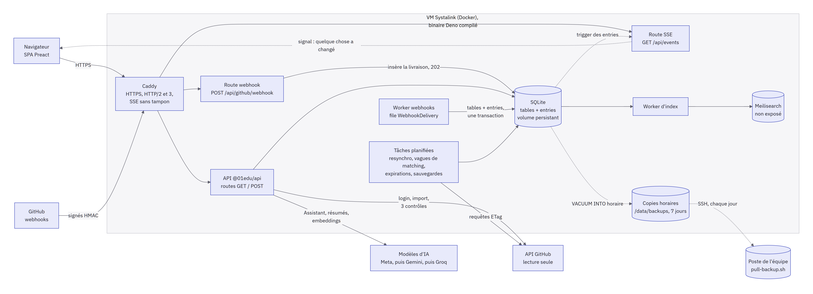](images/1-architecture.png)

Source : [`sources/1-architecture.mmd`](sources/1-architecture.mmd)

## 2. Entité-relation

Conventions (§12.5, §14) : clé primaire `INTEGER` nommée d'après la table (`userId`, `helpRequestId`), comme dans Tournament, unicité par index, dates en `REAL` (millisecondes), JSON validé à l'écriture, clés étrangères appliquées (`PRAGMA foreign_keys = ON`). Il n'y a pas de table d'activité : l'activité est une requête sur les entries. Les liens « polymorphes » (`targetType` + `targetId`) sont notés en commentaire, sans flèche. Les références vers la même table (`Post.parentId`, `ProjectMessage.parentMessageId`…) sont dessinées comme des FK mais n'ont pas de contrainte SQLite (§12.5).

Un diagramme par domaine ; `User` revient dans chacun comme point d'ancrage.

### 2.1 Identité et profil

[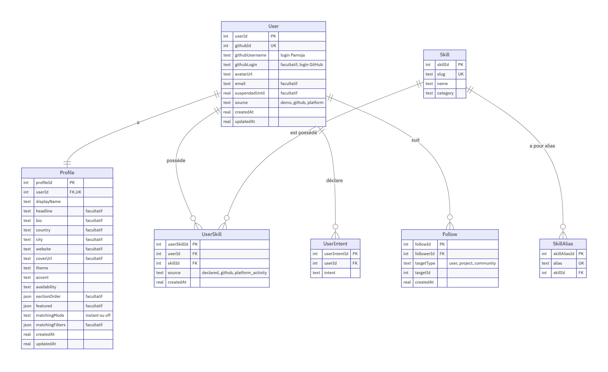](images/2-1-identite.png)

Source : [`sources/2-1-identite.mmd`](sources/2-1-identite.mmd)

### 2.2 GitHub

[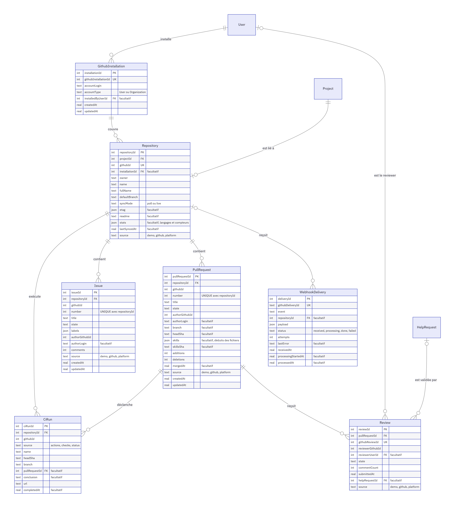](images/2-2-github.png)

Source : [`sources/2-2-github.mmd`](sources/2-2-github.mmd)

Aucune table de tokens : aucun token utilisateur n'est stocké (§5.2).

### 2.3 Projets

[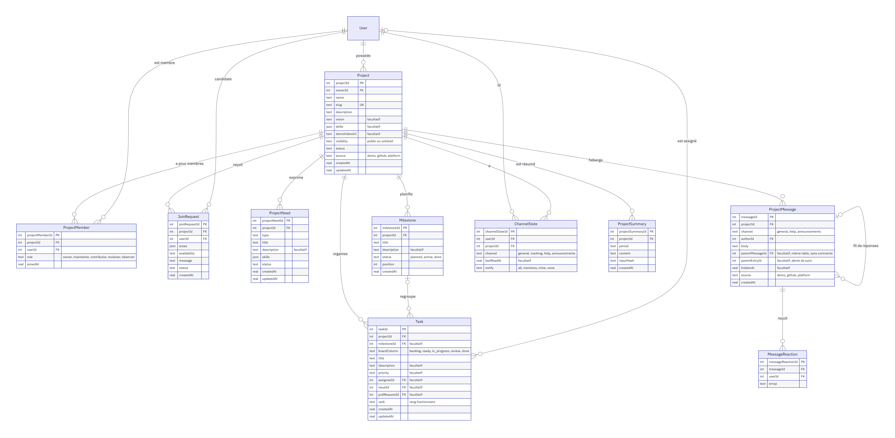](images/2-3-projets.png)

Source : [`sources/2-3-projets.mmd`](sources/2-3-projets.mmd)

Le canal `#suivi` n'a pas de table : il affiche les entries des webhooks.

### 2.4 Aide, matching, réputation

[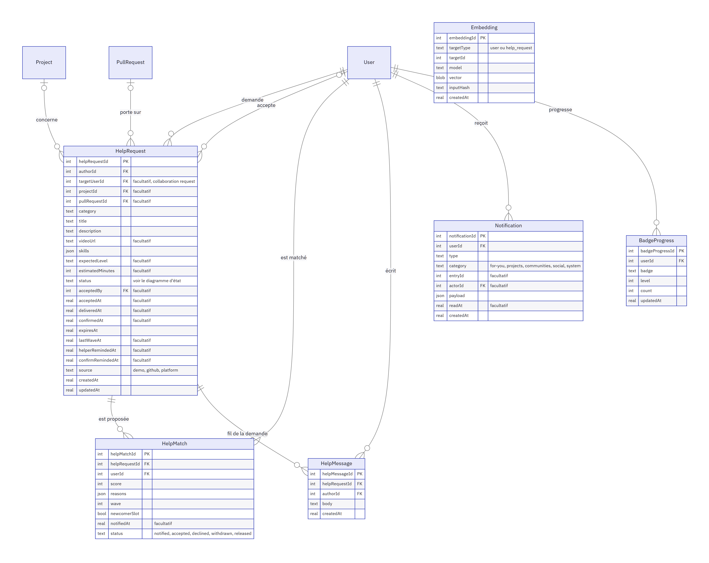](images/2-4-aide.png)

Source : [`sources/2-4-aide.mmd`](sources/2-4-aide.mmd)

Les badges sont des constantes du code (§8.2) ; la réputation se calcule depuis les entries aux `fields` figés (§8.3), pas depuis ces tables.

### 2.5 Communautés, feed et modération

[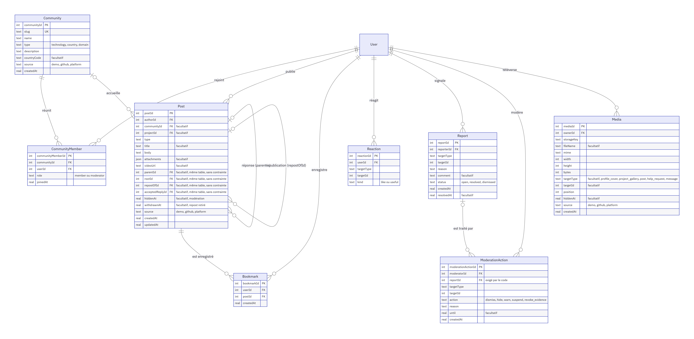](images/2-5-communautes.png)

Source : [`sources/2-5-communautes.mmd`](sources/2-5-communautes.mmd)

### 2.6 Messages directs, Assistant et blocages

Une conversation réunit deux développeurs (§10.6). Son adresse est un `publicId` aléatoire, jamais son numéro. Un premier message adressé à quelqu'un qu'on ne connaît pas est une demande (`pending`) que l'autre accepte ou refuse. Un message supprimé garde sa place sans son texte. L'Assistant (§11) garde la conversation de chaque développeur, lue par lui seul.

[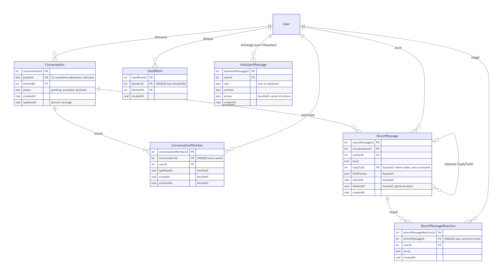](images/2-6-messagerie.png)

Source : [`sources/2-6-messagerie.mmd`](sources/2-6-messagerie.mmd)

### 2.7 Entries

Les entries (`@01edu/db/entries`) ne sont pas une table métier mais le journal de tout ce qui arrive : la réputation, l'activité, la recherche et le temps réel en dépendent. Relations déclarées dans `initEntries` : `userId`, `projectId`, `helpRequestId`, `pullRequestId`, `issueId`, `taskId`, `messageId`, `postId`, `communityId`, `notificationId`. Les types et leurs destinataires sont au §13.3.

## 3. Diagrammes d'état

### 3.1 Demande d'aide

Le diagramme central : seul `completed` produit de la réputation.

[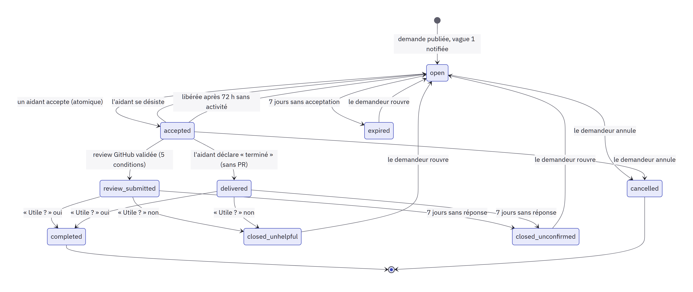](images/3-1-demande-aide.png)

Source : [`sources/3-1-demande-aide.mmd`](sources/3-1-demande-aide.mmd)

| De | Vers | Déclencheur | Effet |
| --- | --- | --- | --- |
| — | `open` | `POST/api/help/create` | Vague 1 (5 développeurs, dont 1 place « prometteur ») ; entries `HELP_REQUEST_CREATED`, `HELP_REQUEST_MATCHED` |
| `open` | `accepted` | `POST/api/help/accept` | `UPDATE … WHERE status = 'open'` : une seule acceptation gagne ; le fil de la demande s'ouvre ; `HELP_REQUEST_ACCEPTED` |
| `open` | `open` | 2 h sans acceptation | Vague suivante, en excluant les aidants sortis |
| `open` | `expired` | 7 jours | `HELP_REQUEST_EXPIRED` |
| `accepted` | `review_submitted` | Webhook `pull_request_review` validé | `REVIEW_SUBMITTED` ; la PR passe en « review reçue » |
| `accepted` | `delivered` | `POST/api/help/deliver` | Le demandeur reçoit « Utile ? » |
| `accepted` | `open` | `POST/api/help/withdraw` ou `release` | `HelpMatch` en `withdrawn` / `released` ; `HELP_REQUEST_WITHDRAWN` / `RELEASED` |
| `review_submitted`, `delivered` | `completed` | `POST/api/help/confirm` | `REVIEW_HELP_CONFIRMED` ou `HELP_CONFIRMED` aux `fields` figés ; évaluateur de badges |
| `review_submitted`, `delivered` | `closed_unhelpful` | Réponse « non » | Aucune réputation |
| `review_submitted`, `delivered` | `closed_unconfirmed` | 7 jours sans réponse | Rappel à 24 h ; aucune réputation |
| `expired`, `closed_*` | `open` | `POST/api/help/reopen` | `HELP_REQUEST_REOPENED` ; mêmes données, vague 1 |
| `open`, `accepted` | `cancelled` | `POST/api/help/cancel` | Final |

### 3.2 Livraison d'un webhook

`WebhookDelivery` sert de file persistante : elle survit aux redémarrages.

[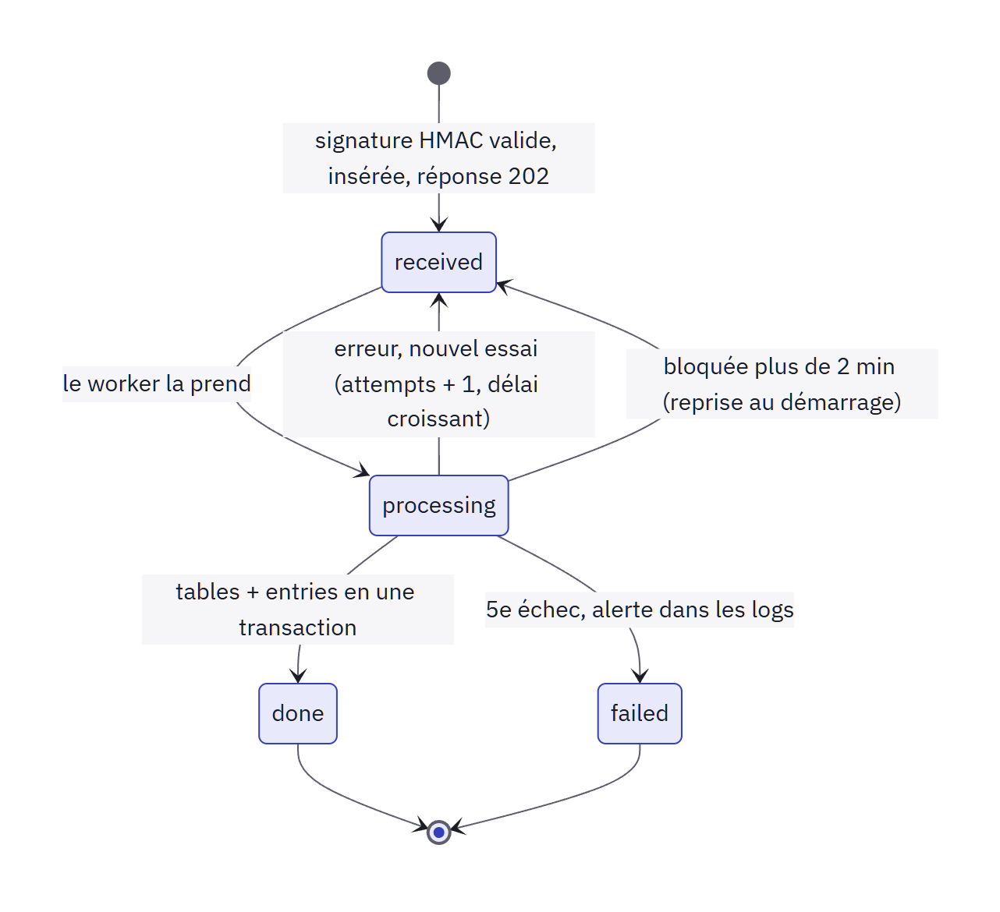](images/3-2-webhook.png)

Source : [`sources/3-2-webhook.mmd`](sources/3-2-webhook.mmd)

Une livraison déjà connue (`githubDeliveryId`) n'est pas réinsérée, et le traitement est idempotent : la rejouer est sans effet de bord.

### 3.3 Synchro d'un projet

[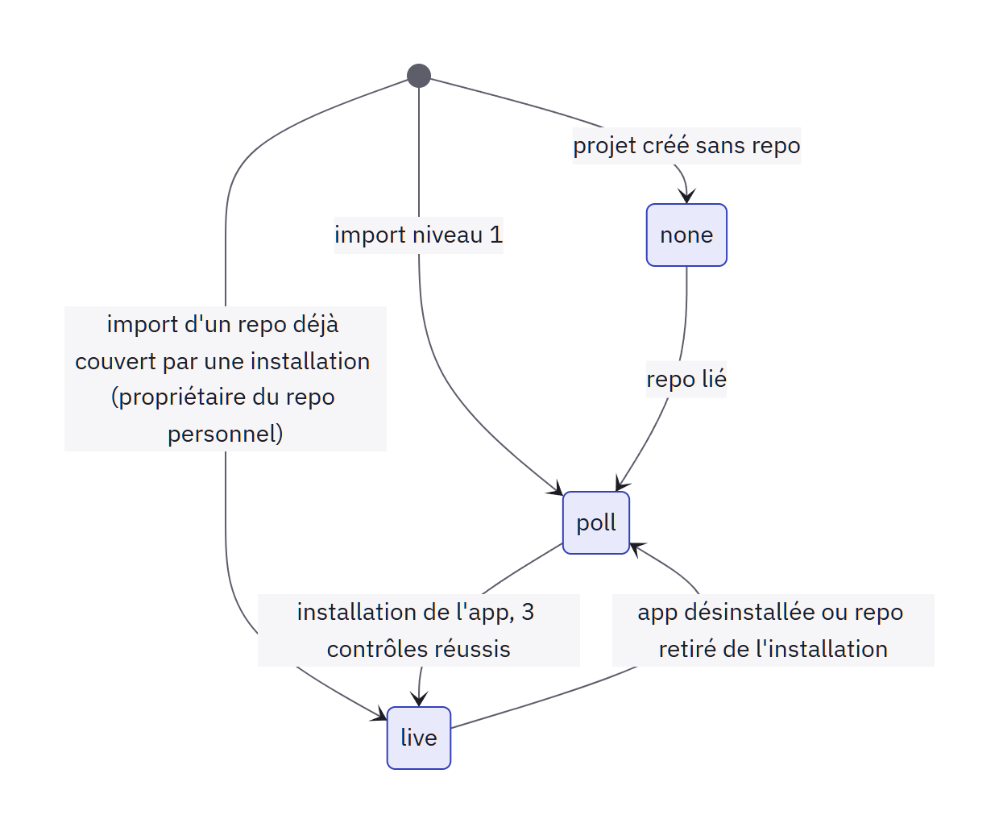](images/3-3-synchro.png)

Source : [`sources/3-3-synchro.mmd`](sources/3-3-synchro.mmd)

En `poll`, la plateforme relit le repo toutes les 15 minutes (requêtes conditionnelles) ; en `live`, les webhooks arrivent en quelques secondes. Dans les deux cas, une resynchronisation horaire rattrape les webhooks perdus.

## 4. Diagrammes de séquence

### 4.1 Connexion avec GitHub

[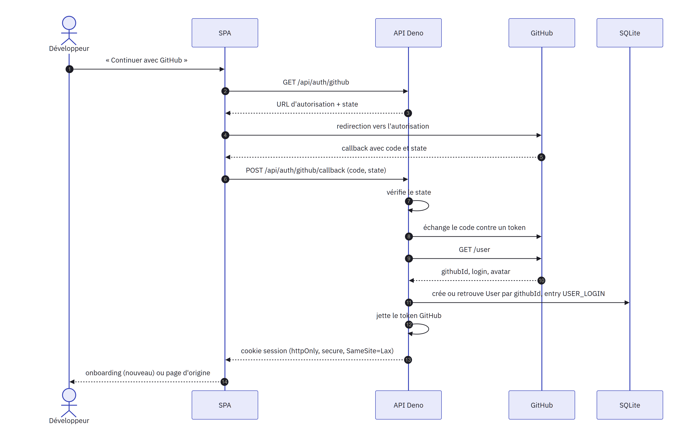](images/4-1-connexion.png)

Source : [`sources/4-1-connexion.mmd`](sources/4-1-connexion.mmd)

### 4.2 Passage en synchro live (installation de l'app)

[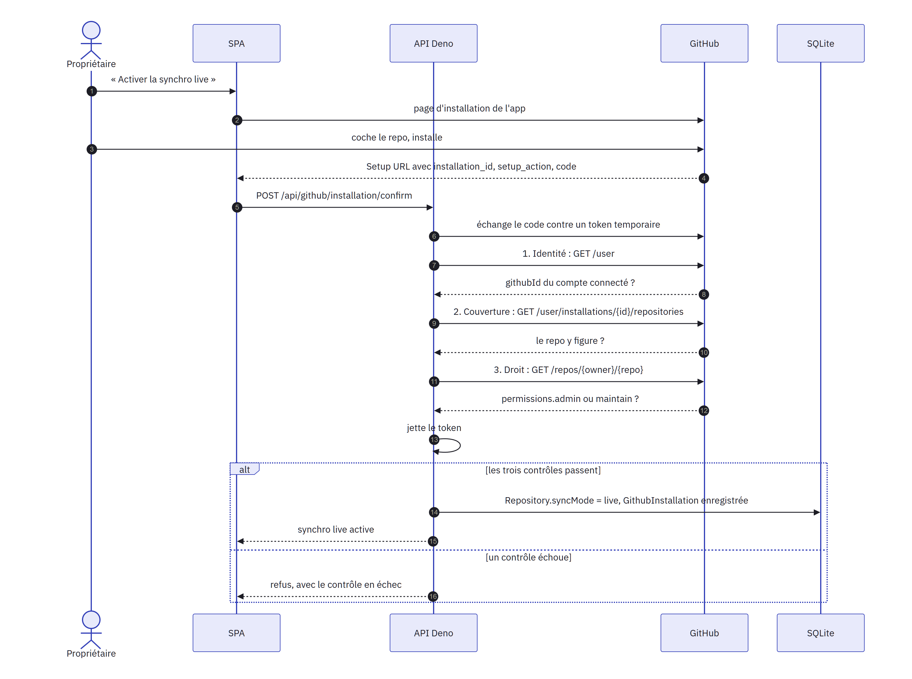](images/4-2-synchro-live.png)

Source : [`sources/4-2-synchro-live.mmd`](sources/4-2-synchro-live.mmd)

### 4.3 Boucle de démo : de la demande à la preuve

Le scénario du §18, côté serveur.

[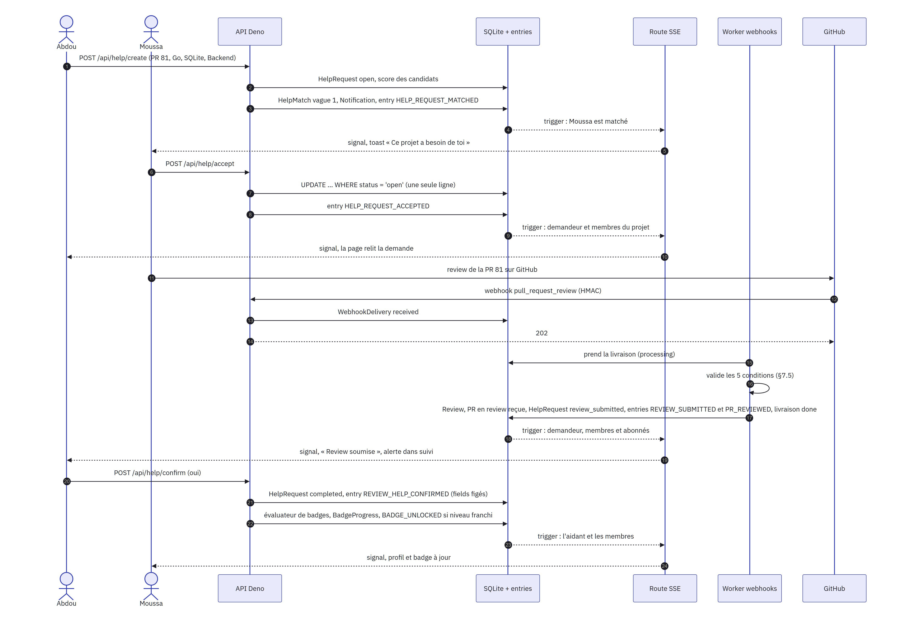](images/4-3-boucle-demo.png)

Source : [`sources/4-3-boucle-demo.mmd`](sources/4-3-boucle-demo.mmd)

## 5. Flowcharts

### 5.1 Traitement d'un webhook

[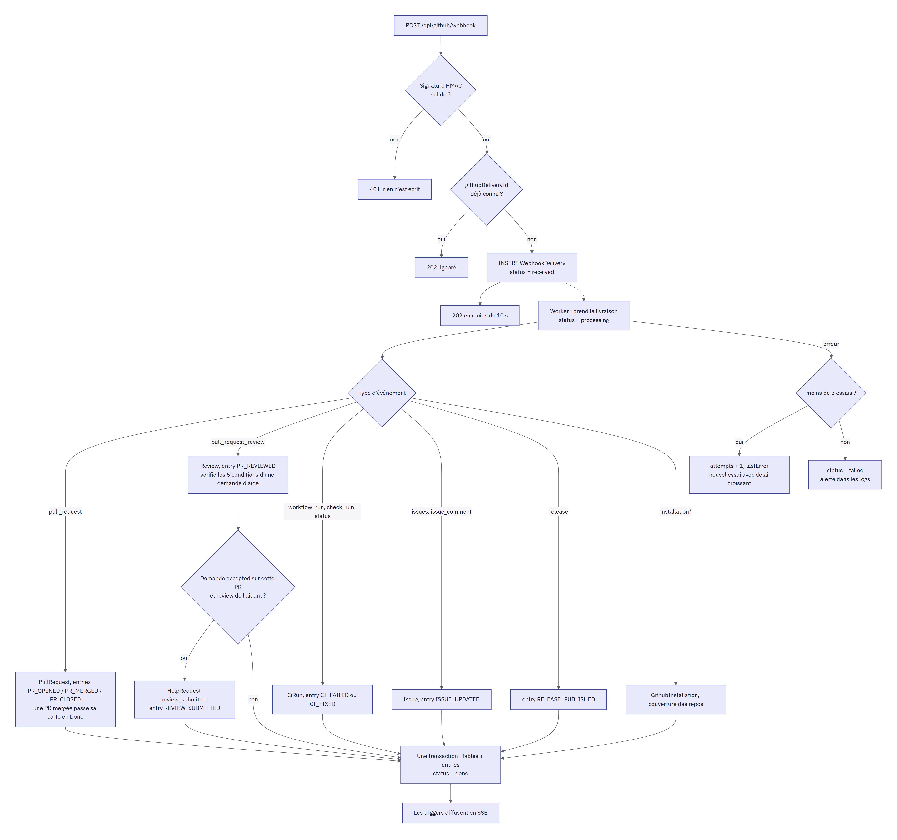](images/5-1-webhook.png)

Source : [`sources/5-1-webhook.mmd`](sources/5-1-webhook.mmd)

### 5.2 Calcul du matching

[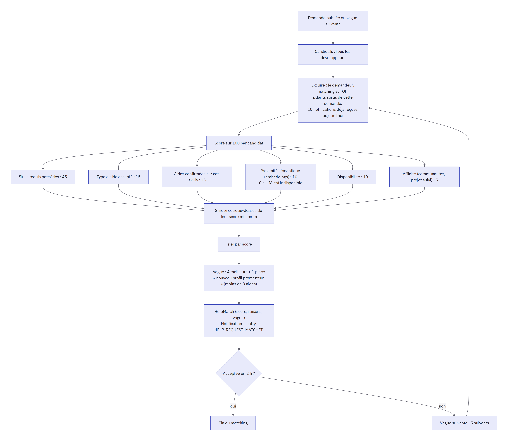](images/5-2-matching.png)

Source : [`sources/5-2-matching.mmd`](sources/5-2-matching.mmd)

« Pourquoi ce match ? » affiche exactement les critères qui ont compté, avec leurs points.

## 6. Modèle de domaine

Le back n'a presque pas de classes (des routes, des fonctions et des tables) : ce diagramme montre les objets métier, leurs règles et leurs liens, sans détail de stockage.

[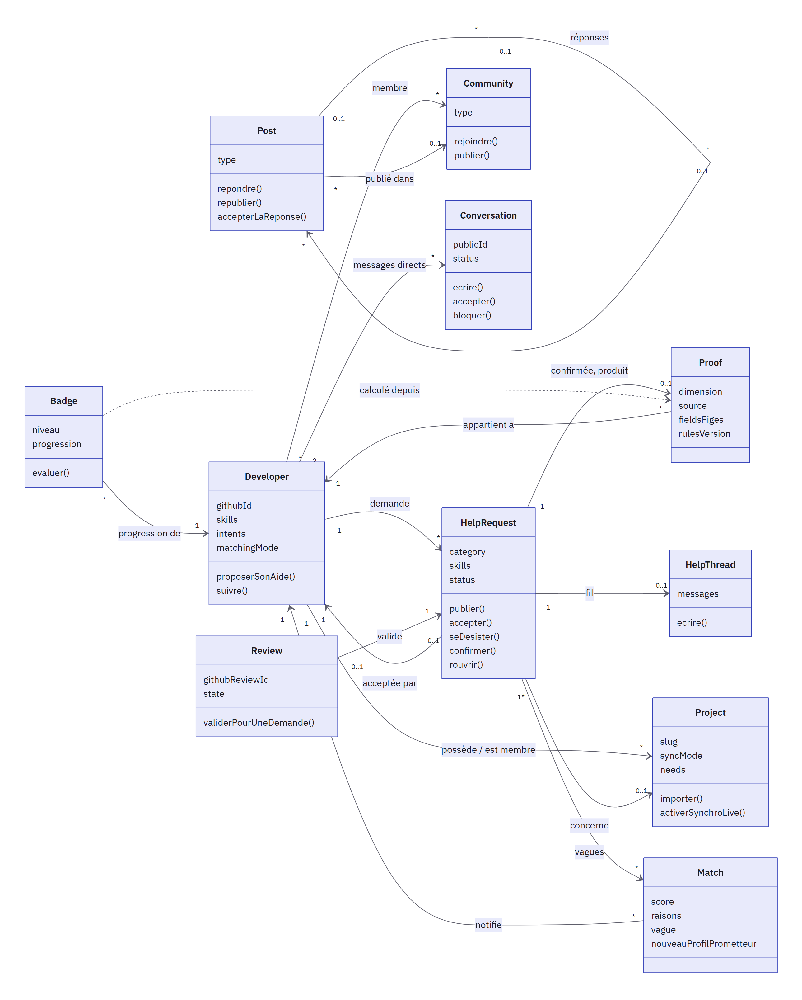](images/6-domaine.png)

Source : [`sources/6-domaine.mmd`](sources/6-domaine.mmd)
