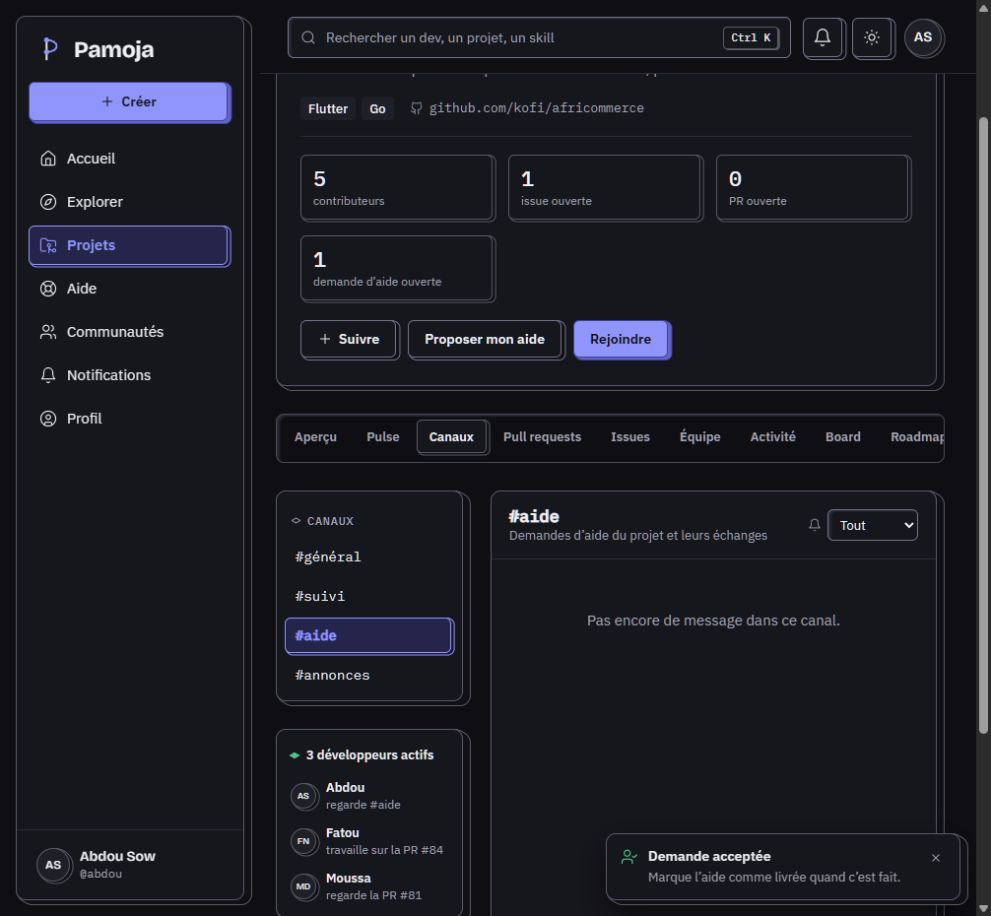
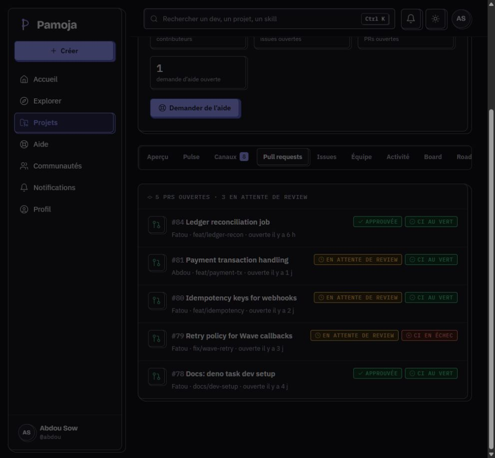
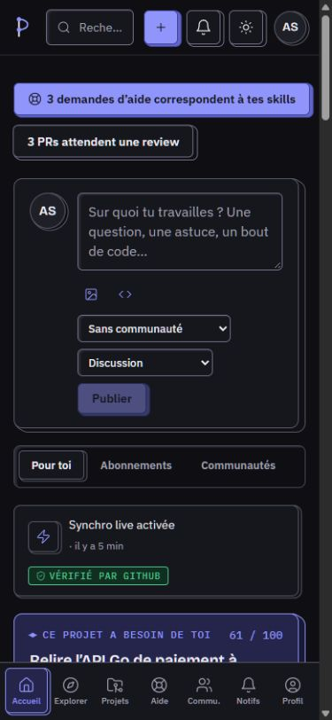
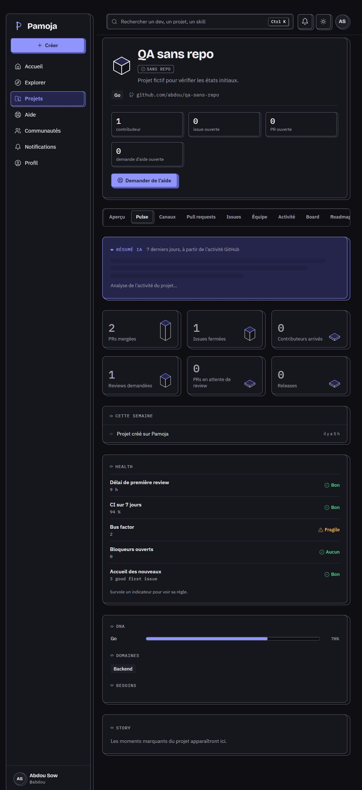
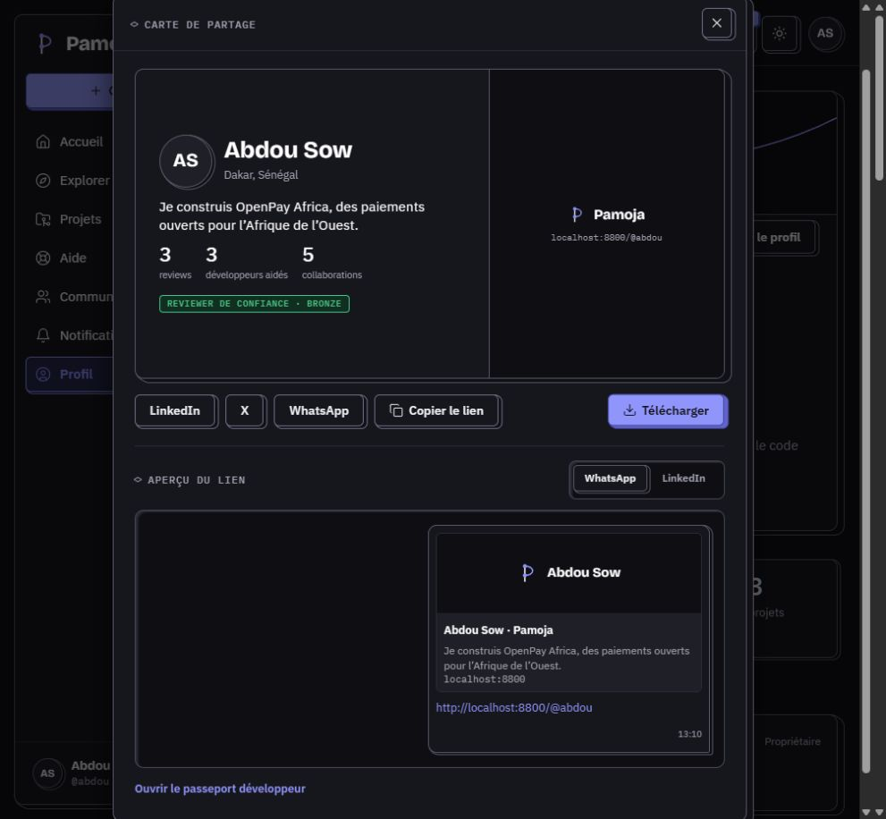
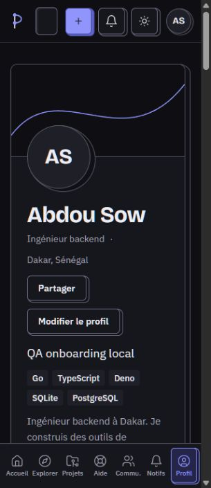

# QA front Pamoja — 10 octobre 2026

**Verdict : front non validé pour gel avant branchement du back.** Les principaux écrans sont navigables et plusieurs parcours aboutissent, mais deux ruptures touchent directement la boucle d'aide. Ce rapport est un audit, pas une livraison de corrections.

## Conditions

- Révision inspectée : `1f129b6`, arbre initial propre.
- Sources lues : `CLAUDE.md`, `TODO.md`, journal de progression, README du prototype, sections pertinentes du cahier des charges et code des parcours.
- App lancée sur `http://localhost:8800`, via `deno serve --env-file=.env-dev -A --port=8800 task-dev.ts`. Le serveur seul évite le formatage automatique inclus dans `deno task dev`.
- Navigateur intégré Codex ; vue bureau disponible et tailles explicites 390 × 844 et 320 × 740. Thèmes clair et sombre observés ; thème Système restauré.
- Compte fictif Abdou. Les écritures exécutées modifient les fixtures du navigateur, sans API métier ni envoi réel à GitHub. Un rechargement réinitialise ces données.
- Observations par navigation réelle, DOM/accessibilité, captures et lecture ciblée du code. Pas de validation sur téléphone physique ni de mesure de performance réseau.
- Aucun code applicatif corrigé, aucun commit ou PR créé.

## Couverture effectuée

« Partiel » signifie que la page ou le formulaire a été examiné, mais que tout son cycle n'a pas été validé.

| Parcours | Test effectué | Résultat |
| --- | --- | --- |
| Accueil connecté | Fil, liens de projet, rédaction, navigation | Navigable ; événement de synchro cassé après mutation, QA-03 |
| Landing / connexion | Déconnexion, landing mobile, autorisation GitHub simulée | Aboutit à l'onboarding |
| Onboarding | Cinq étapes, alias `postgres`, sélection Backend, retour navigateur, import passé | Profil et skills mis à jour ; deux h1, QA-13 |
| Passeport → connexion → collaboration | Passeport de Moussa, lien Collaborer, autorisation | Revient au bon profil avec dialogue ouvert |
| Demande depuis PR #81 | Préremplissage, publication fictive, réponse simulée, confirmation | Demande terminée et compteur Moussa 14 → 15 ; projet incohérent, QA-02 |
| Demande depuis CI #79 | Alerte #suivi → Debug, PR, branche, job, skills | Préremplissage correct ; Annuler retourne à #suivi |
| Formulaire aide vide | Soumission vide sur mobile | Erreurs titre et skills, focus sur titre |
| Aidant | Accepter h1, accès proposé à #aide, désistement confirmé | Canal inutilisable, QA-01 ; recommandation persistante, QA-08 |
| Liste d'aide | Pour moi, compteurs et statut après désistement | Affichage accessible ; filtre à corriger |
| Import GitHub | Wave SDK Go, aperçu, création | 3 contributeurs, 2 issues et 1 PR conservés |
| Synchro live | Dialogue, installation simulée, trois contrôles, activation | Aboutit ; provenance et fil incorrects, QA-03/10 |
| Création sans repo | Validation vide, création « QA sans repo » avec Go | Aboutit ; faux lien et faux historique, QA-04/06 |
| Projet | Aperçu, PR et drawer, issues, équipe, activité, réglages | Toutes les sections ouvertes ; lecture et destinations inspectées |
| Board | Création d'une carte et déplacement vers Prêt par flèche | Carte, compteurs et activité mis à jour |
| Roadmap | Lecture des milestones existantes et absence à l'import | Affichage accessible ; édition non exercée |
| Canaux | #général, message fictif, #suivi, non-lus, accès aidant | Message affiché ; non-lus incohérents, QA-07 |
| Candidature | Dialogue et soumission vide | Erreur et focus corrects ; envoi rempli bloqué par contrôle automatique |
| Explorer | Développeurs, filtres Go + Ghana, état vide, Projets, Travail | Résultats et URL des filtres cohérents sur les cas testés |
| Recherche | `postgress`, flèche bas + Entrée, résultats complets | PostgreSQL trouvé ; ouverture de Dakar Transit correcte |
| Profil | Statistiques, preuves, édition, ordre des sections, annulation | Aperçu réagit ; navigation fonctionne |
| Partage | Carte, copie du lien, téléchargement, passeport public | Copie correcte ; PNG prévu côté back et retour invisible, QA-09 |
| Communautés | Liste, confirmation Quitter/Rester, Go : fil/membres/aide/à propos | Navigation et confirmation fonctionnent |
| Nouveau post | Menu Créer, audience, choix Demande d'aide | Renvoi vers formulaire d'aide correct ; audience incohérente, QA-11 |
| Nouvelle communauté | Ouverture et inspection du formulaire | Partiel : création et doublon non rejoués |
| Discussion | Question SQLite et réponses, ouverture d'une réponse ciblée | Affichage et champ de réponse présents ; envoi non effectué |
| Enregistrés | Enregistrer un post, lien Voir vers la liste | Post retrouvé dans Enregistrés |
| Notifications | Tri visible, tout marquer lu, notification PR #80 | Compteurs remis à zéro, bon drawer ouvert |
| Réglages | Thèmes et export JSON | Fichier `pamoja-abdou.json` téléchargé ; contenu non audité exhaustivement |
| Signalement | Ouverture depuis un post | Bon objet et auteur ; envoi non effectué |
| Modération | Accès direct comme Abdou | Message réservé aux modérateurs ; actions modérateur non exercées |
| 404 | Route inexistante et retour accueil | Page et retour fonctionnent ; deux h1, QA-13 |
| Mobile | Accueil, projet/PR, formulaire aide, landing/onboarding, profil et partage | Pas de débordement horizontal de document sur les vues mesurées ; recherche vide à 320 px |

## Défauts prioritaires

P1 : bloque un parcours central ou la démonstration. P2 : incohérence fonctionnelle à corriger avant validation front. P3 : défaut de finition ou accessibilité.

### QA-01 · P1 · L'aidant accepté ne peut pas utiliser le canal proposé

1. Ouvrir `/aide/h1` comme Abdou et accepter.
2. Cliquer « Écrire dans #aide ».
3. Arrivée sur `/projet/africommerce/canaux/aide` : aucun champ de message, texte « Rejoins le projet pour écrire ici ».

**Attendu :** une voie de communication utilisable immédiatement après l'acceptation. La règle actuelle réserve #aide aux membres : il faut décider d'un espace d'échange de demande ou d'un accès explicite limité, puis aligner le CTA. Ne pas ouvrir implicitement tous les canaux.

**Cause :** `web/pages/help/help-detail.tsx:179` propose toujours #aide ; `web/pages/project/channels-tab.tsx:391` autorise l'écriture selon l'appartenance au projet uniquement. La présence affichée cite aussi Fatou/PR #84 et Moussa/PR #81 même dans AfriCommerce.

### QA-02 · P1 · La review confirmée n'est pas répercutée sur le projet

1. OpenPay → PR #81 → Demander une review → publier le formulaire prérempli.
2. Attendre les réponses simulées puis « Oui, elle m'a aidé ».
3. La demande passe à Terminée, Moussa passe de 14 à 15 reviews.
4. Rouvrir PR #81 : « En attente de review », « Aucune review pour l'instant », et simultanément « Demande d'aide : Terminée · Moussa ».
5. Pulse garde 3 PRs en attente ; #suivi et activité ne reçoivent pas cet événement.

**Attendu :** une seule transition de review alimente demande, PR, Pulse, canaux et activité ; 3 → 2 PRs en attente selon le scénario §18.2. La confirmation ajoute ensuite la réputation sans rejouer la review.

**Cause :** `web/fixtures/help.ts:233` actualise demande et notifications, mais pas les fixtures PR/activité/canaux ; Pulse lit encore les PRs inchangées.

### QA-03 · P2 · L'événement de synchro de l'accueil perd son projet

Importer Wave SDK Go, activer la synchro simulée, revenir à l'accueil. La carte « Synchro live activée » n'affiche pas le nom et contient un lien vide vers `/projet/undefined/canaux/suivi`.

**Cause confirmée :** `web/pages/home/home-page.tsx:237`, `<GithubEvent project={project} {...entry} />`. Les entrées créées pendant la session contiennent `project` sous forme de slug (`web/fixtures/activity.ts:18`) ; le spread écrase l'objet Project attendu.

**Attendu :** nom Wave SDK Go et destination `/projet/wave-sdk-go/canaux/suivi`.

### QA-04 · P2 · Pulse invente l'historique et les mesures d'un nouveau projet

Créer de zéro « QA sans repo », techno Go, puis Pulse : 2 PRs mergées, 1 issue fermée, 1 review demandée, CI 94 %, bus factor 2, 3 good first issues. Le projet n'a ni repo ni activité GitHub. DNA affiche Go 70 % seul. À l'import Wave, l'aperçu indique Go 94 % / Makefile 6 %, mais Pulse devient Go 70 % / Backend 30 %.

**Cause :** valeurs génériques `quietWeek`, health figé et fallback des langages depuis les skills dans `web/fixtures/pulse.ts:90`, `:125`, `:145`.

**Attendu :** états zéro/inconnu adaptés, distribution des vrais langages du repo, aucun domaine métier présenté comme langage.

### QA-05 · P2 · Résumé IA en chargement sans fin sur les projets créés/importés

Sur Pulse de Wave SDK Go ou QA sans repo, « Analyse de l'activité du projet… » reste affiché bien après le délai simulé de 2,6 secondes. Vérifié par retour ultérieur sur le contenu et lecture du code.

**Cause :** `web/pages/project/pulse-tab.tsx:30` affiche le squelette dès que `text` manque, même après `ready=true`. Aucun résumé n'existe pour les nouveaux slugs.

**Attendu :** repli déterministe et état « résumé indisponible » ou section absente, conformément au §6.4/§11.

### QA-06 · P2 · Un projet sans repo possède un faux lien GitHub et aucune action pour le lier

Créer QA sans repo. Son en-tête affiche `github.com/abdou/qa-sans-repo` malgré « Sans repo ». Les réglages disent seulement « Ce projet n'est pas encore lié à un repo GitHub », sans action, alors que le formulaire promet de pouvoir le lier plus tard.

**Cause :** lien construit sans condition dans `web/pages/project/project-page.tsx:206` ; état sans repo des réglages sans CTA.

**Attendu :** masquer le lien absent et fournir un parcours front de liaison, ou indiquer clairement son indisponibilité provisoire.

### QA-07 · P2 · Les non-lus des canaux reviennent après lecture

OpenPay : badge Canaux 8 → ouvrir général → 6 → ouvrir suivi → 4 → quitter vers Board → 8. Général redevient non lu ; le message écrit par soi-même entre aussi dans le comptage de sa liste.

**Cause documentée dans le code :** tous les messages hors canal actif sont considérés non lus (`project-page.tsx:246`, `channels-tab.tsx:422`). PAM-412 back est en attente, mais la simulation front ne permet pas de valider le comportement prévu.

**Attendu :** conserver un curseur lu par canal dans la session front, exclure ses propres envois, synchroniser badge et listes.

### QA-08 · P2 · Une demande refusée par désistement reste recommandée

Accepter h1, Se désister → Me désister. Le détail dit « Tu ne la recevras plus » et n'affiche plus Accepter, mais Aide → Pour moi la propose toujours avec score 61.

**Cause :** `web/fixtures/help.ts:158`, `matchingRequests()` ne filtre pas `withdrawn`. Les surfaces utilisant cette fonction peuvent donc continuer de recommander la demande.

**Attendu :** exclusion immédiate des recommandations et compteurs, tout en conservant l'historique consultable.

### QA-09 · P2 · Le retour des actions de partage est caché par le dialogue

Profil → Partager → Télécharger : aucun retour visible ni téléchargement. Le DOM contient « Téléchargement bientôt disponible — L'image PNG 1200 × 630 arrive avec la génération côté serveur », mais le toast se trouve derrière le dialogue. La copie réussit, mais sa confirmation rencontre le même problème.

**Cause :** dialogue natif `showModal()` (`web/ui/dialog.tsx:48`) dans la couche supérieure ; toasts dans le layout avec seulement `z-60` (`web/ui/toast.tsx:118`).

**Attendu :** retour dans le dialogue, ou mécanisme de toast compatible avec cette couche. Le PNG est une limite back prévue ; le retour masqué est un défaut front.

### QA-10 · P2 · Des simulations affichent « Vérifié par GitHub »

Après import fictif et activation fictive de synchro, les événements de la session affichent ce badge sans aucune vérification GitHub réelle. Les entrées seedées sont correctement marquées Démo, mais les nouvelles simulations ne le sont plus.

**Cause :** `event.session` implique VerifiedBadge (`web/pages/project/event-list.tsx:49`, `web/pages/home/home-page.tsx:138`). « Créé dans la session » ne signifie pas « vérifié ».

**Attendu :** provenance explicite des fixtures et badge Démo/Simulation pour toutes ces actions ; badge vérifié réservé à une source vérifiée.

### QA-11 · P2 · Le menu Créer impose une audience différente de l'accueil

Accueil : rédaction avec « Sans communauté ». Menu global Créer → Post : Go choisi par défaut, aucune option Sans communauté. Un utilisateur peut donc publier dans Go sans avoir choisi cette audience, alors que le même post depuis l'accueil reste sur son profil.

**Cause :** `web/ui/new-post-dialog.tsx:40`, communauté initiale forcée ; liste sans option neutre.

**Attendu :** même audience par défaut dans les deux entrées globales ; préremplir la communauté seulement lorsqu'on vient de sa page.

### QA-12 · P3 · Recherche visuellement vide à 320 px

À 320 × 740, l'en-tête réduit la recherche à un rectangle sans icône visible ni texte. Le contrôle conserve son nom accessible, mais n'est plus identifiable visuellement.

**Piste :** `web/ui/header.tsx:66`, largeur disponible après les actions fixes ; icône de recherche qui peut rétrécir. Prévoir un bouton icône avec largeur minimale.

### QA-13 · P3 · Deux h1 sur connexion, onboarding et 404

Les snapshots exposent « Connexion » + « Autoriser Pamoja », « Bienvenue » + titre d'étape, « Page introuvable » + « Ce lien ne mène nulle part » comme deux titres de niveau 1.

**Cause :** `Page` ajoute un h1 masqué par défaut, et ces pages rendent aussi leur h1 visible. Utiliser `heading={false}` comme les autres pages à titre visible. Régression par rapport au critère PAM-120.

### QA-14 · P3 · Singulier oublié dans la liste des PRs

Importer Wave SDK Go puis Pull requests : « 1 PRs ouvertes · 1 en attente de review ». L'en-tête du projet affiche correctement « 1 PR ouverte ».

**Cause :** texte fixe dans `web/pages/project/pull-requests-tab.tsx:116`. Réutiliser le helper `plural` déjà présent dans le projet.

## Limites de validation et travail restant

- **Écritures bloquées :** le contrôle automatique a refusé l'envoi d'une candidature remplie, même après lecture de `apply()` confirmant une mutation locale en mémoire. Une demande d'autorisation explicite a été posée ; aucune approbation spécifique reçue pendant cet audit. L'envoi de candidature n'est pas validé. Publication de posts, signalement et création de communauté n'ont pas été exécutés ; leurs formulaires ont été inspectés.
- **Pas de session modérateur disponible via l'interface testée :** décisions, suspension et retrait de preuves non validés. Aucun rôle n'a été forcé par injection.
- **Chargement/erreur :** `LoadingState` et `ErrorState` existent dans `web/ui/states.tsx`, mais aucune page ne les importe. Les états réseau et la récupération après erreur restent à rendre testables côté front. Seuls les chargements locaux d'import, connexion et résumé ont été observés.
- **Persistance :** session, créations et brouillons sont en mémoire. Les rechargements réinitialisent le jeu fictif et reconnectent Abdou par défaut. Ne pas interpréter cela comme une validation de session, sauvegarde ou reprise après panne.
- **Autres cas non couverts :** upload réel d'images, limites de taille/formats, lecteurs vidéo externes, téléchargement PNG/OG serveur, tests tactiles physiques, lecteurs d'écran, glisser-déposer tactile, concurrence multiutilisateur, toutes les combinaisons de rôles/permissions, expirations 24 h/72 h/7 j.
- **Retour focus des modales :** observé sur certaines fermetures vers le menu du compte plutôt que le lien attendu ; comportement à isoler au clavier dans une passe dédiée avant d'affirmer la conformité PAM-120. Non compté comme défaut certain ici.

## Vérifications techniques

| Commande / observation | Résultat |
| --- | --- |
| `deno lint` | OK, 116 fichiers |
| `deno check web/app.tsx` | Code de sortie 0 |
| `deno task test` | Code de sortie 0, **0 test exécuté** |
| `deno fmt --check` | Échec : 11 fichiers sur 120, différences de fins de ligne uniquement |
| Console navigateur consultée | Aucune entrée warn/error renvoyée au moment du contrôle |

Fichiers concernés par le formatage : `api/lib/env.ts`, `api/lib/log.ts`, `api/routes.ts`, `api/server.ts`, `build-config.ts`, `deno.json`, `prod-server.ts`, `task-dev.ts`, `task-prod.ts`, `task-generate-icons.js`, `task-generate-theme.ts`. Aucun formatage automatique effectué.

## Ordre de correction et critères de retest

1. Débloquer la conversation de l'aidant ; rejouer acceptation → communication sans devenir membre de tout le projet.
2. Unifier la simulation de review ; rejouer PR #81 → demande → review → confirmation, vérifier PR, Pulse, #suivi, activité et profil ensemble.
3. Corriger les objets d'activité, la provenance Démo, les données de Pulse et l'état sans repo ; rejouer import et création vierge sans recharger.
4. Aligner recommandations après désistement, compteurs de non-lus, audience des posts et retours de dialogues.
5. Refaire une passe clavier/mobile, rendre chargement/erreur testables et terminer les soumissions restées non validées.

**Validation globale : non acquise.** La couverture ci-dessus constitue une passe transversale réelle, pas une garantie exhaustive de toutes les branches de l'application.
